# Testimonial Collection SaaS

A SaaS platform where users create testimonial collection pages ("Spaces"), share a
public link, collect testimonials from customers who don't need an account, manage
them in an inbox, and display selected ones on external websites via an embeddable
widget.

Built as a **Java 21 / Spring Boot 4.1** API plus a **Next.js 16** frontend, with
PostgreSQL, Flyway, Stripe billing, and Cloudflare Turnstile.

> The product spec lives in [`docs/PRD-testimonial-saas.md`](docs/PRD-testimonial-saas.md).
> Section references below (PRD 4.3, PRD 6.12, …) point into it.
> Engineering rules and the hard-won gotchas live in [`CLAUDE.md`](CLAUDE.md).

---

## Screenshots

Captured from the running app: Spring Boot on `:8080` and a Next.js production
build on `:3000`, against a seeded PostgreSQL with three Spaces and fourteen
testimonials.

### Dashboard

Submissions per day, the headline counts and recent submissions. Days with no
submissions show 0, and the range is selectable.

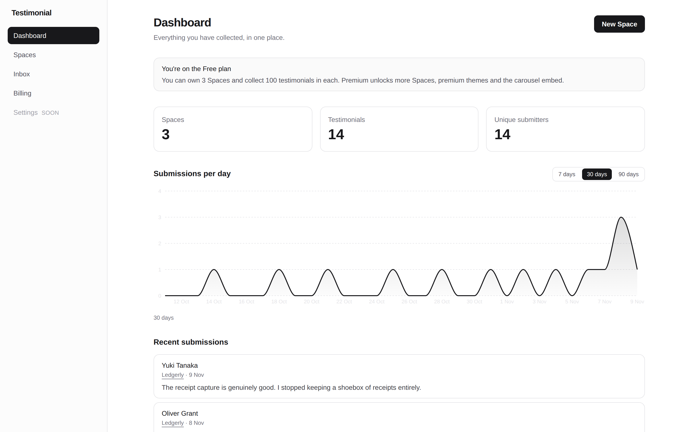

### Inbox

Favourites sort above the rest. Every row carries its rating, submission date
and the Wall of Love badge, with the owner actions inline.

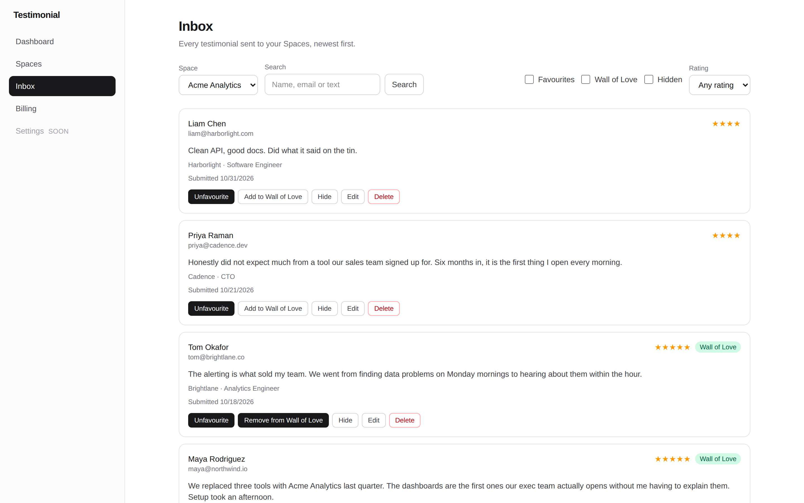

### Public submission page

The visitor-facing form, rendered in the Space's own theme and asking only for
the fields the owner configured. No account needed.

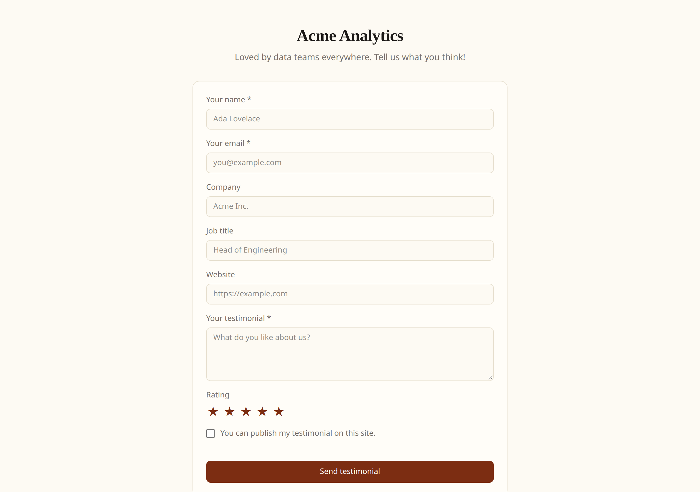

### Thank-you page

After a successful submission, with a random GIF from the bundled set.

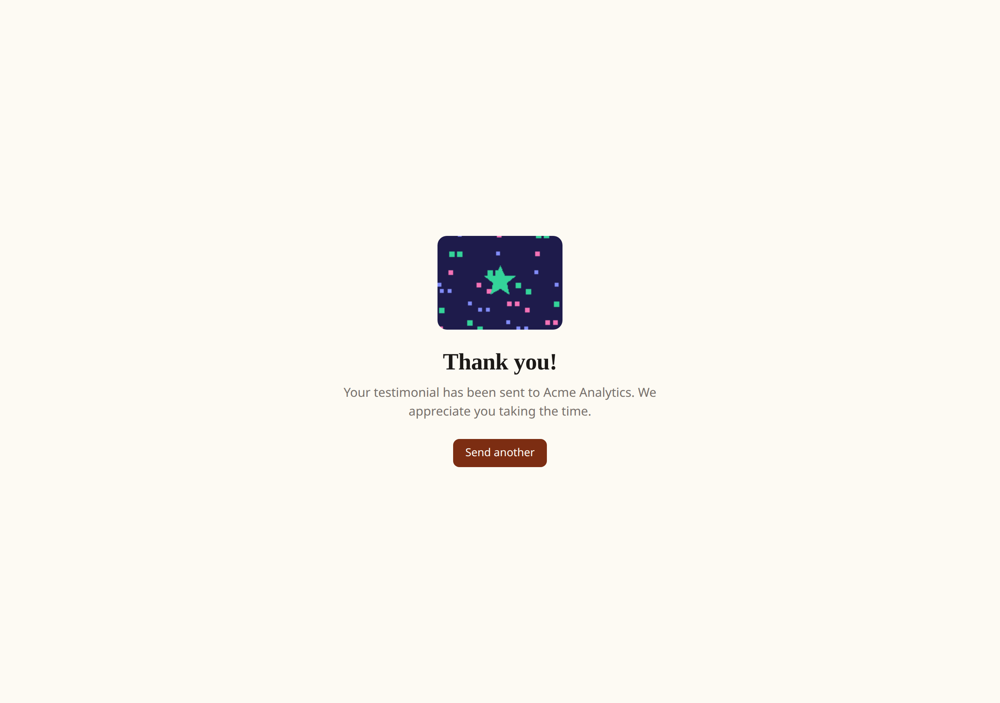

### Embed configurator

A live preview that updates on every change, the copyable snippet, and the
Premium options locked for a Free account.

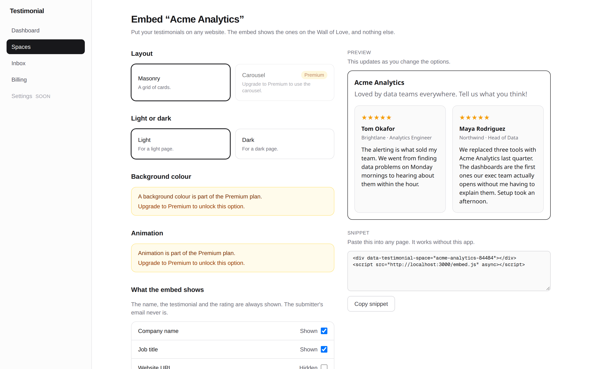

### The embed on an external site

The snippet pasted into a plain HTML page — no React, no build step. It shows
only the testimonials that are on the Wall of Love *and* visible.

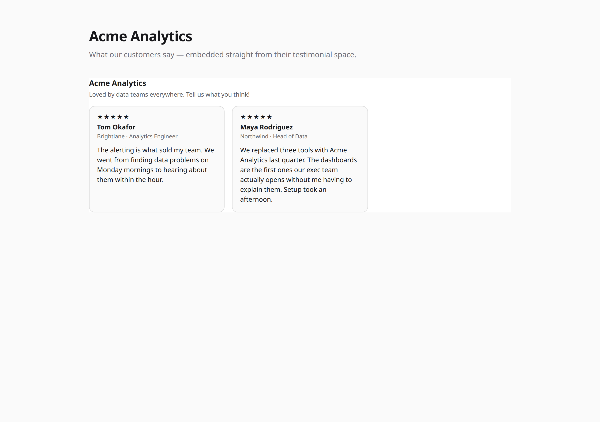

### Creating a Space

The wizard's theme step: every theme with a preview, premium themes marked,
and the public page updating live on the right.

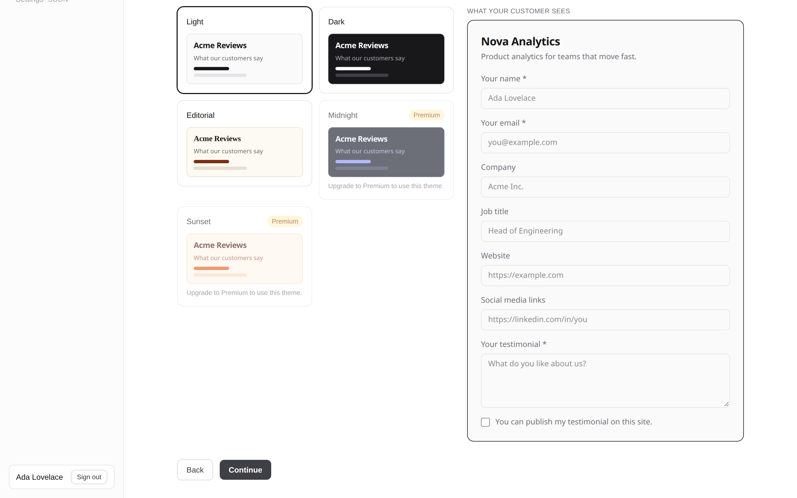

### Billing

The current plan and the two plan options side by side.

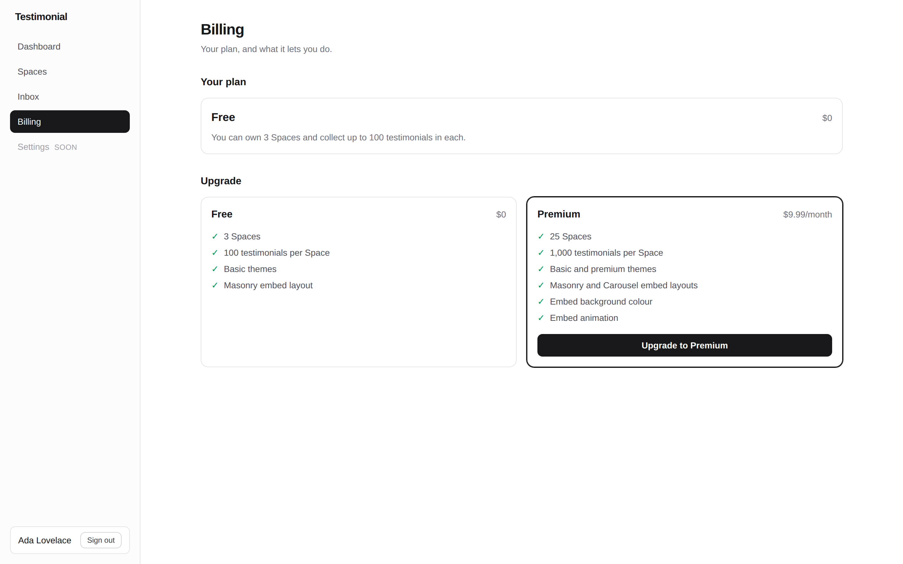

### Space detail

The public URL, the form configuration, and the rating setting.

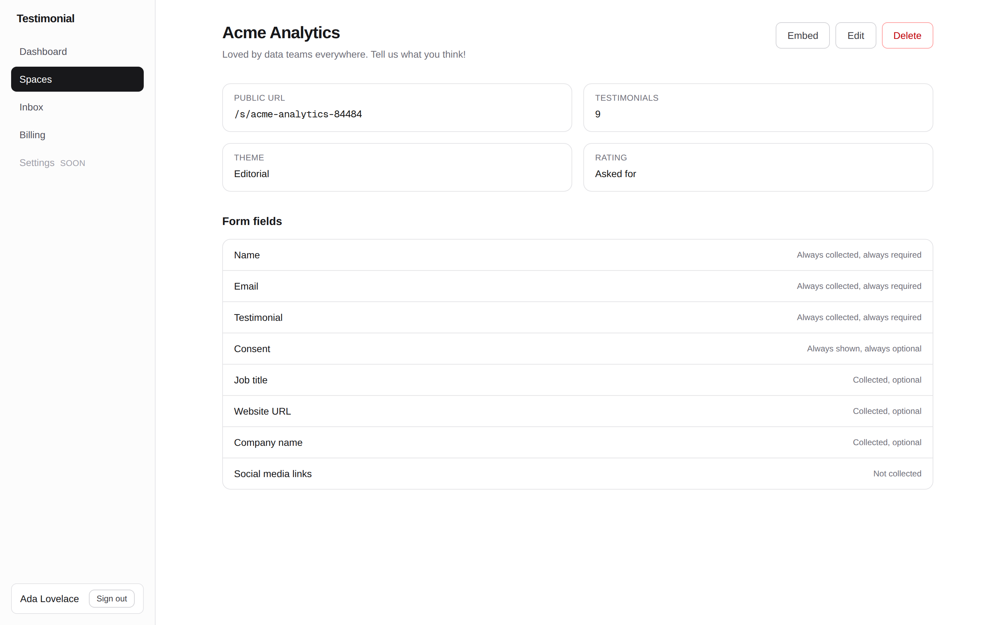

### Dark mode

The dashboard follows the system colour scheme, chart included.

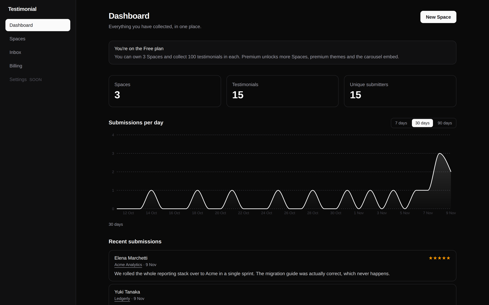

### Mobile

The public submission page on a phone-sized viewport.

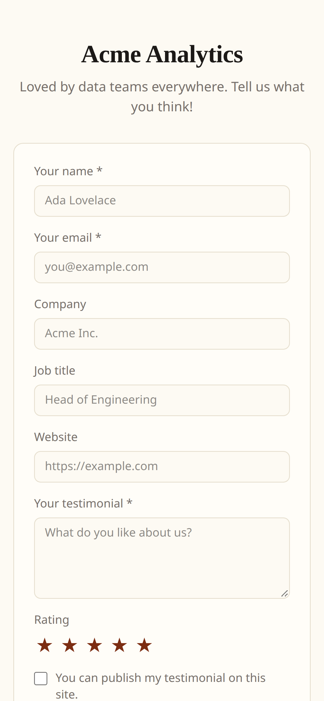

### Authentication

| Sign in | Register | Forgot password |
|---|---|---|
| 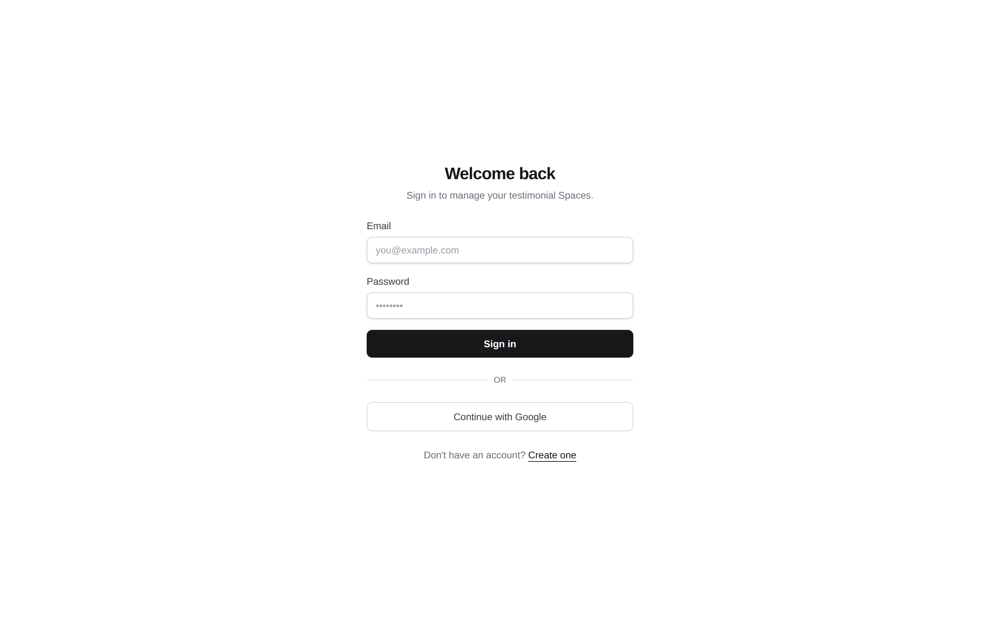 | 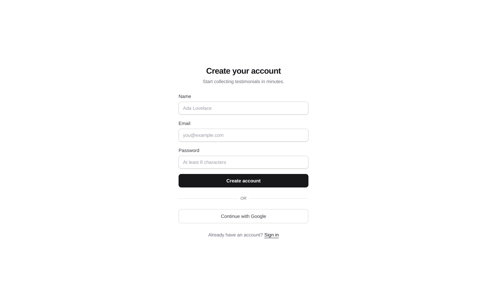 | 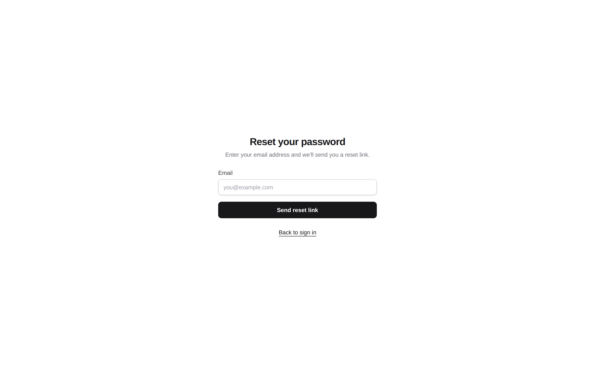 |

---

## Contents

- [Stack](#stack)
- [Prerequisites](#prerequisites)
- [Running the project](#running-the-project)
- [Configuration](#configuration)
- [Testing](#testing)
- [Feature status](#feature-status)
- [Agentic tooling](#agentic-tooling)
- [Project layout](#project-layout)

---

## Stack

| Layer | Technology |
|---|---|
| Backend | Java 21, Spring Boot 4.1, Spring Security, JPA/Hibernate 7, Flyway, PostgreSQL 17 |
| Frontend | Next.js 16 (App Router), React 19, TypeScript, Tailwind CSS v4 |
| Charts | Recharts 3 (lazy-loaded, ~105 KB gzipped) |
| Billing | Stripe (Checkout + signature-verified webhooks) |
| Abuse protection | Cloudflare Turnstile, Bucket4j per-IP rate limiting |
| Testing | JUnit 5 + Testcontainers (backend), Vitest (frontend unit), Playwright (frontend e2e) |

---

## Prerequisites

| Tool | Version | Check with |
|---|---|---|
| Node.js | >= 20.9.0 (Next.js 16 requirement) | `node -v` |
| Java | 21+ | `java -version` |
| Docker + Docker Compose | any recent | `docker compose version` |

The backend uses the bundled Maven wrapper (`./mvnw`) — no local Maven install
needed. The frontend uses `npm`.

---

## Running the project

### 1. Start PostgreSQL

```bash
docker compose up -d
```

This starts PostgreSQL 17 on `localhost:5432` with database `testimonial` and
credentials `testimonial` / `testimonial`. Flyway applies all migrations on
backend startup, so the schema is created for you.

### 2. Run the backend

```bash
cd backend/testimonial
./mvnw spring-boot:run -Dspring-boot.run.profiles=local
```

- API: `http://localhost:8080`
- Swagger UI: `http://localhost:8080/swagger-ui.html`
- Health/actuator: `http://localhost:8080/actuator/health`

### 3. Run the frontend

```bash
cd frontend/testimonial
npm install
npm run dev
```

App: `http://localhost:3000`

### 4. Try it end to end

1. Register at `http://localhost:3000/register` (or sign in with Google).
2. Verify your email — in local development the backend logs the verification
   link to stdout rather than sending it. Open it, then land on the dashboard.
3. Create a Space via the wizard. You get a public URL like
   `http://localhost:3000/s/<slug>`.
4. Open that URL in a private window and submit a testimonial. You get the
   thank-you page with a random GIF.
5. Manage it in the **Inbox** (favorite, Wall of Love, hide, edit, delete).
6. Configure the **embed** and paste the snippet into a plain HTML page.

### Without external accounts

Google sign-in, Stripe and Turnstile all degrade gracefully when unconfigured:

| Service | Behaviour with no credentials |
|---|---|
| Google OAuth2 | The backend context still boots (placeholder client id), and email/password sign-in works normally. The login page *does* still render a "Continue with Google" link, which then fails at the provider — see [Not done](#not-done). |
| Stripe | Checkout is unavailable; the rest of the app runs on the Free plan. |
| Turnstile | The CAPTCHA step is skipped entirely (`captchaToken` is simply omitted). |
| SMTP | Verification and reset emails are logged to stdout instead of sent. |

---

## Configuration

Secrets are environment variables only — never commit them. Copy
`.env.example` to `.env` (backend) or `.env.local` (frontend) and fill in what
you need.

| Variable | Purpose |
|---|---|
| `SPRING_DATASOURCE_URL` / `_USERNAME` / `_PASSWORD` | Postgres connection |
| `APP_PUBLIC_BASE_URL` | Base URL used to build links in emails |
| `GOOGLE_CLIENT_ID` / `GOOGLE_CLIENT_SECRET` | Google sign-in. Redirect URI: `http://localhost:8080/login/oauth2/code/google` |
| `STRIPE_SECRET_KEY` / `STRIPE_PUBLISHABLE_KEY` | Stripe test-mode keys |
| `STRIPE_WEBHOOK_SECRET` | Webhook signature verification secret |
| `TURNSTILE_SECRET_KEY` | Server-side CAPTCHA verification |
| `NEXT_PUBLIC_TURNSTILE_SITE_KEY` | Public site key (safe in the browser) |
| `MAIL_HOST` / `_PORT` / `_USERNAME` / `_PASSWORD` / `_FROM_ADDRESS` | Outbound SMTP |
| `NEXT_PUBLIC_API_BASE_URL` | Backend URL the browser calls |

---

## Testing

```bash
# Backend — unit + Testcontainers integration (269 tests)
cd backend/testimonial && ./mvnw test

# Frontend unit tests (Vitest)
cd frontend/testimonial && npm test

# Frontend type-check and lint
cd frontend/testimonial && npm run typecheck
cd frontend/testimonial && npm run lint

# End-to-end (Playwright — 67 tests, requires both servers running)
cd frontend/testimonial && npm run test:e2e
```

### Running the e2e suite reliably

The Playwright suite drives the **real backend**, so both servers must be up.
Two settings keep it green — both of them work around the environment, not the
application:

**Run the frontend as a production build.** `next dev` grows past 9 GB of
memory over a few hours and the parallel browser workers then hit request
timeouts that look like application bugs:

```bash
cd frontend/testimonial
npm run build && npm run start
```

**Give the backend a webhook secret and a large submission rate limit.** The
billing specs sign webhook payloads the way Stripe does, so the backend needs
the same secret. The public-submission endpoint is rate limited per IP, and the
whole suite shares one IP, so the limit must be raised or the later specs get
a 429:

```bash
cd backend/testimonial
STRIPE_WEBHOOK_SECRET=whsec_e2e_test_secret \
SUBMISSION_RATE_LIMIT_CAPACITY=100000 \
SUBMISSION_RATE_LIMIT_REFILL_SECONDS=1 \
./mvnw spring-boot:run -Dspring-boot.run.profiles=local
```

No Stripe account is needed — the webhook endpoint verifies the signature
itself, and the event types the specs use carry everything the application needs
in the payload, so nothing calls out to Stripe.

---

## Feature status

Every row below was checked against the running code, not against the PRD text.

### Done

| Area | PRD | Notes |
|---|---|---|
| Email + password registration | 4.1 | Case-insensitive unique email, BCrypt, min 8 chars |
| Login / logout | 4.1 | Short-lived access JWT + rotating refresh token, both in HttpOnly cookies |
| Google sign-in | 4.1 | First-time Google users are auto-verified; Google signs into an existing account with the same email (OPEN-A default) |
| Email verification | 4.1 | Expiring, single-use link; unverified users can log in but cannot create Spaces |
| Forgot / reset password | 4.1 | Expiring, single-use link |
| Spaces CRUD | 4.2 | Slug auto-generated from title, editable until the first submission, then locked |
| Space creation wizard | 4.2 | Title → fields → theme → ratings → success page with copy-link |
| Plan limits on Spaces | 4.2, 7 | Free 3 / Premium 25, enforced on the backend |
| Form configuration | 4.3 | Name and Email are fixed and required; four optional fields, each required/optional; consent checkbox always shown and optional |
| Themes | 4.4 | 3 basic + 2 premium, with preview; premium themes rejected on the backend for Free accounts, and a downgraded Space keeps its premium theme |
| Public submission page | 4.5 | Mobile-first, renders the Space's configured fields and theme |
| Thank-you page | 4.5 | Random GIF from four bundled assets |
| Abuse protection | 4.5 | Bucket4j per-IP rate limit, honeypot field, Cloudflare Turnstile, inert rendering of submitted HTML |
| Dashboard stats | 4.6 | Spaces, testimonials, unique submitters (distinct email), all scoped to the owner; UTC daily buckets; deleted testimonials excluded |
| Free-plan upgrade notice | 4.6 | The dashboard shows a "You're on the Free plan" panel with the limits and what Premium unlocks; hidden for Premium accounts |
| Submissions chart | 4.6 | Daily time series over a selectable range (default 30 days), zero-filled days, lazily loaded |
| Recent submissions | 4.6 | Last 10, each linking to its Space |
| Inbox | 4.7 | Favourites first then newest, search across name/email/text, filters, pagination |
| Inbox actions | 4.7 | Favourite, Wall of Love, hide/show, edit, delete — all persisted and owner-scoped |
| Wall of Love + embed config | 4.8 | Masonry (Free) and Carousel (Premium), light/dark, background colour and animation as Premium; live preview; generated snippet with copy button |
| Public embed widget | 4.8 | Self-contained `public/embed.js` with no React dependency, scoped CSS, XSS-safe (`textContent` only, never `innerHTML`), 404 renders nothing without breaking the host page |
| Public embed API | 4.8 | Read-only, unauthenticated, cacheable, cross-origin, email never exposed |
| Stripe checkout | 4.9 | Checkout Session created by the backend; the redirect alone never upgrades the account |
| Stripe webhooks | 4.9 | Signature verified (invalid → 400), idempotent per event id, plan changes only from a verified event |
| Cancellation / resume | 4.9 | Takes effect at period end; Premium continues until then; resumable before the date passes |
| Past due | 4.9 | Status becomes past due, Premium is retained; final failure downgrades to Free |
| Downgrade without data loss | 4.9 | No data deleted; Spaces beyond the Free limit become read-only (oldest 3 stay editable — OPEN-B default) |
| Read-only Space | 4.9 | Viewable, existing embeds keep rendering, no new submissions, mutating actions disabled in the UI and rejected by the backend |
| Scheduled cleanup | — | Expired verification/reset tokens, revoked refresh tokens and processed Stripe events are pruned on a schedule, each in its own transaction |

### Not done

| Area | PRD | Notes |
|---|---|---|
| **Account settings page** | 4.10 | No `/settings` route. Updating name and password, and viewing email verification status, are not built. The one `settings` match in the frontend is unrelated (a Space detail page field). |
| **Google sign-in button when unconfigured** | 4.1 | The backend boots with placeholder Google credentials, but the login page renders the "Continue with Google" link unconditionally, so clicking it with no real client id configured sends the user to a failing Google authorization. The link should be hidden when the client id is absent. |
| **Image / video testimonials** | 2 | Explicit non-goal. |
| **Workspaces, teams, roles** | 2 | Explicit non-goal — one user is one account. |
| **Drag-and-drop form builder, custom fields** | 2, 4.3 | Explicit non-goal — the field set is fixed. |
| **Custom domains, white-label, agency features** | 2 | Explicit non-goal. |
| **Integrations, AI features, social import** | 2 | Explicit non-goal. |
| **Notifications beyond auth and Stripe email** | 2 | Explicit non-goal. |
| **Account deletion** | 2 | Explicit non-goal. |
| **Social login other than Google** | 2 | Explicit non-goal. |
| **Annual billing, free trial** | 2 | Explicit non-goal — monthly only, no trial. |

### Known gaps in what *is* built

These are real limitations in shipped features, not non-goals:

- **Embed content is capped at 100 testimonials** (`EmbedService.EMBED_LIMIT`).
  A Space with more than 100 Wall-of-Love items shows the newest 100 and the
  owner gets no signal that the list is truncated — the public embed payload
  carries no `total`.
- **The embed's `inbox` search index is large.** The V4 migration adds a
  trigram index over the concatenated searchable text of every testimonial,
  measured at roughly 70% of the table's size. Fine at MVP volumes, worth
  watching as a Wall of Love grows.
- **No e2e spec asserts the chart actually draws.** The dashboard spec asserts
  the chart's accessible label, which is rendered by the lazy-loaded chart's
  *shell* — so a broken lazy import of the Recharts plot would not be caught.
  The Recharts SVG itself is currently unverified end to end.

---

## Agentic tooling

The project was built with **Puku CLI**, an agentic coding CLI. The tooling used
and where it lives:

### Subagents

| Subagent | What it was used for | Where |
|---|---|---|
| `code-reviewer` | Audited the whole working tree before the final pass — correctness, tenant isolation, migration safety, test quality. Its own notes are kept alongside the project. | `.puku-cli/agents/code-reviewer.md`, `.puku-cli/agent-memory/code-reviewer/` |
| `general-purpose` | Exploratory sweeps across the backend and frontend when locating the code behind a PRD clause. | `.puku-cli/agents/` |

The code-reviewer run is what surfaced the dead `InboxService.listAll` method, the
ineffective `memo` in `inbox.tsx`, and the silent embed truncation described
under [Known gaps](#known-gaps-in-what-is-built).

### Skills

Skills are installed from upstream repositories, pinned by hash in
[`skills-lock.json`](skills-lock.json) so every session gets the same version.

| Skill | Source | Where |
|---|---|---|
| `postgres` | `planetscale/database-skills` | `.agents/skills/postgres/`, `agent/skills/postgres/` |
| `mysql` | `planetscale/database-skills` | `.agents/skills/mysql/`, `agent/skills/mysql/` |
| `neki` | `planetscale/database-skills` | `.agents/skills/neki/`, `agent/skills/neki/` |
| `vitess` | `planetscale/database-skills` | `.agents/skills/vitess/`, `agent/skills/vitess/` |
| `vercel-react-best-practices` | `vercel-labs/agent-skills` | `.agents/skills/vercel-react-best-practices/` |

The `postgres` skill informed the V4 migration's index design (trigram index for
substring search, a covering index for the inbox count query). The
`vercel-react-best-practices` skill informed the lazy-loading split of the
submissions chart into `submissions-chart.tsx` (shell) and
`submissions-chart-plot.tsx` (the lazily imported Recharts chunk).

The `mysql`, `neki` and `vitess` skills are installed but **not used** — this
project is PostgreSQL-only.

### Persistent memory

The agent keeps a file-based memory of the project at
`.puku-cli/agent-memory/`, which is how the hard-won gotchas in
[`CLAUDE.md`](CLAUDE.md) accumulated: the Hibernate 7 / Boot 4 type-mapping
table, the `TestRestTemplate` package move, the shared Testcontainers pattern,
the nested-form and wizard-submit-button traps, and the four causes of e2e
flake.

### Project instructions

[`CLAUDE.md`](CLAUDE.md) is the project's agent instruction file — it is read
into every session and encodes the backend, frontend and testing rules the
agent must follow (Flyway owns the schema, the Hibernate type mappings,
`permitAll()` is not enough for a cross-origin endpoint, never nest a live
`<form>`, assert exact values, and so on).

### Hooks and MCP

None are configured in this repository. There is no `.mcp.json`, no
`settings.json` with a `hooks` block, and no MCP server is wired up — the
`update-config` skill is available for adding them if the project later needs
one.

---

## Project layout

```
backend/testimonial/       Spring Boot API — a modular monolith, packaged by feature
  src/main/java/com/yamin/testimonial/
    auth/                  registration, login, JWT, refresh tokens, Google OAuth2, mail
    spaces/                Spaces, form definitions, themes, plan limits
    testimonials/          public submission, inbox, rate limiting, Turnstile
    embed/                 embed configuration and public embed content
    billing/               Stripe checkout, subscriptions, webhook processing
    analytics/             dashboard aggregates
    common/                base entities, error handling, scheduled cleanup
  src/main/resources/db/migration/   Flyway migrations (V1 … V4)
frontend/testimonial/      Next.js App Router app
  app/(auth)/              register, login, forgot/reset password, verify email
  app/(dashboard)/         dashboard, spaces, inbox, billing, space detail, embed
  app/s/[slug]/            the public submission page and thank-you page
  components/              shared UI (inbox, wizard, embed configurator, charts)
  lib/                     types + typed API client per domain (spaces, testimonials,
                           embeds, billing, analytics, auth, session, public-spaces)
  e2e/                     Playwright specs
  public/embed.js          the self-contained embed widget
docs/                      the PRD
docs/screenshots/           the screenshots used in this README
agent/, .agents/           installed agent skills
.puku-cli/                 agent memory and subagent definitions
```

---

## License

Proprietary.
